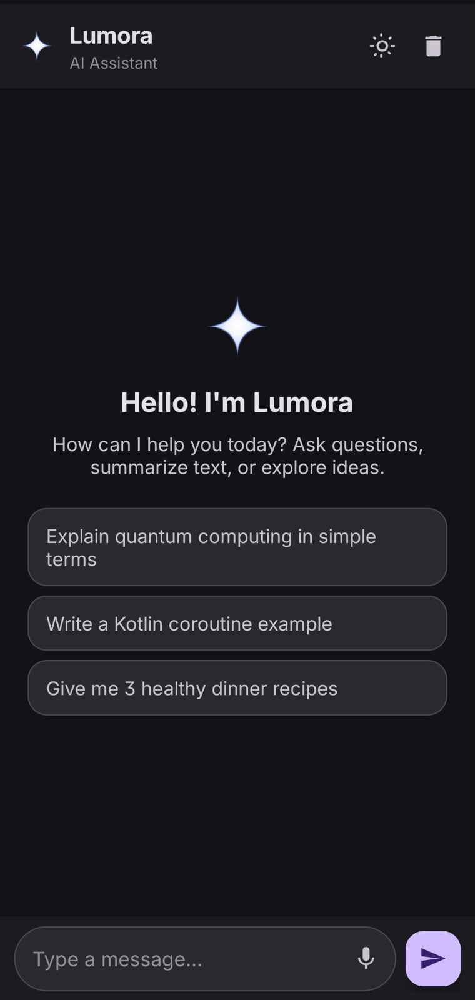
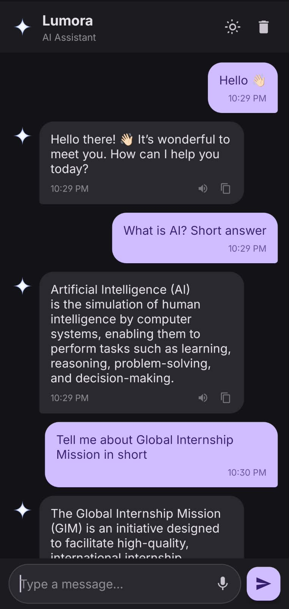
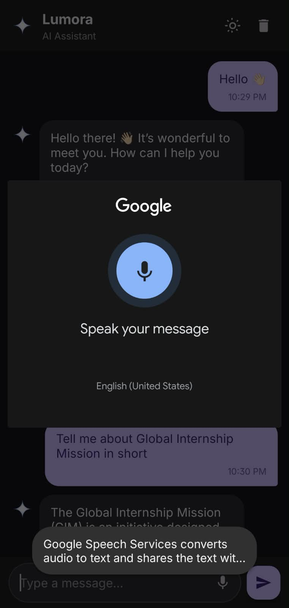

# 🤖 AI Chatbot App (✨Lumora)

An Android AI chatbot application developed using **Kotlin** and the **Groq API** as part of the **App Dev With AI Internship 2026**.

The application provides a conversational interface where users can send messages and receive AI-generated responses.

## 📱 App Screenshots

### 🏠 Home Screen



### 💬 AI Conversation



### 🎙️ Voice Input



## ✨ Features

- 💬 Interactive chatbot interface
- 🤖 AI-generated responses using the Groq API
- 🎙️ Voice input using speech recognition
- 📋 Copy AI responses to the clipboard
- 🌓 Light and dark theme support
- 🧹 Clear chat functionality
- 💡 Suggested prompts for quick interaction
- 📱 Android-friendly user interface

> Note: Features listed above should match the functionality implemented and working in your current version of the app.

## 🛠️ Technologies Used

| Technology | Purpose |
|---|---|
| Kotlin | Android application development |
| Android Studio | Development environment |
| XML | User interface layouts |
| Groq API | AI-generated responses |
| Kotlin Coroutines | Asynchronous operations |
| StateFlow | Reactive chat state management |
| RecyclerView | Displaying chat messages |
| Git and GitHub | Version control and source code hosting |

## 🚀 Getting Started

### Prerequisites

- Android Studio
- Android SDK
- Git
- A valid Groq API key

### Installation

**1. Clone the repository**

```bash
git clone https://github.com/Sk-Kamrej/AI-Chatbot-App.git
```

**2. Open the project**

Open Android Studio, select **Open**, and choose the cloned `AI-Chatbot-App` directory.

**3. Sync Gradle**

Wait for Gradle synchronization to complete and resolve any dependency issues.

**4. Configure the API key**

Configure your Groq API key using a secure local configuration method supported by your application.

Do not commit API keys, passwords, or other secrets to GitHub.

**5. Run the application**

Connect an Android device or start an emulator, then click **Run** in Android Studio.

## 📂 Project Structure

```text
AI-Chatbot-App/
├── app/
│   └── src/
│       └── main/
│           ├── java/
│           │   └── com/example/ai_chatbot_app/
│           ├── res/
│           │   ├── drawable/
│           │   ├── layout/
│           │   └── values/
│           └── AndroidManifest.xml
├── screenshots/
│   ├── home-screen.png
│   ├── chat-conversation.png
│   └── voice-input.png
├── gradle/
├── .gitignore
├── build.gradle.kts
├── gradle.properties
├── gradlew
├── gradlew.bat
├── settings.gradle.kts
└── README.md
```

*The structure above is illustrative; your actual project may contain additional files or directories.*

## 🎓 Internship Details

**Program:** App Dev With AI Internship 2026
**Organization:** Global Internship Mission
**Final Assignment:** AI Chatbot Application

This project was developed as part of the App Dev With AI Internship 2026 offered by Global Internship Mission. 
It demonstrates practical skills in Android application development using Kotlin, XML layouts, and AI API integration.

## 👨‍💻 Author

**SK Kamrej**

- GitHub: [@Sk-Kamrej](https://github.com/Sk-Kamrej)
- Project Repository: [AI-Chatbot-App](https://github.com/Sk-Kamrej/AI-Chatbot-App)

## 📄 License

This project is licensed under the MIT License. See the [LICENSE](LICENSE) file for details.
